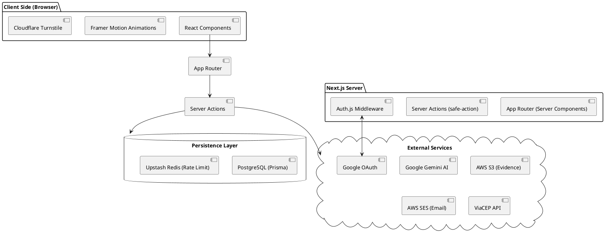

# 07 - Arquitetura do Sistema

## 7.1 Visão Geral da Arquitetura

O **AnonProtect** utiliza uma arquitetura fullstack moderna baseada no framework Next.js. O sistema é dividido em três camadas lógicas principais: Frontend, Backend e Camada de Dados.

### 7.1.1 Frontend (React Server Components)

Responsável pela interface do usuário e renderização otimizada. Utiliza componentes do lado do servidor para reduzir o tempo de carregamento e componentes de cliente para interatividade (como o chat e o dashboard).

### 7.1.2 Backend (Server Actions & API Routes)

Processa a lógica de negócio, autenticação e validação de dados. As **Server Actions** atuam como ponte segura entre o formulário do usuário e o banco de dados, enquanto as API Routes lidam com integrações externas como o callback do Google OAuth.

### 7.1.3 Camada de Dados (Prisma & PostgreSQL)

Gerencia a persistência das informações. O Prisma atua como a interface de consulta, garantindo integridade referencial e tipagem forte em todas as operações. O sistema também utiliza o **Upstash Redis** para gerenciamento de rate limit distribuído.

## 7.2 Diagrama de Arquitetura (PlantUML)

## 7.3 Segurança e Privacidade (LGPD)

O sistema foi projetado seguindo os princípios de _Privacy by Design_:

### 7.3.1 Criptografia em Repouso

Todas as descrições de denúncias são criptografadas utilizando o algoritmo **AES-256-GCM** antes de serem persistidas no banco de dados. Isso garante que, mesmo em caso de vazamento da base de dados, o conteúdo permanece ilegível sem a `ENCRYPTION_KEY`.

### 7.3.2 Camada de Anonimização (PII Redaction)

Utiliza-se Inteligência Artificial (Gemini) para detectar e redigir automaticamente Informações de Identificação Pessoal (PII) como nomes, e-mails, CPFs e telefones, gerando uma versão segura para visualização padrão.

### 7.2.4 Governança e Transparência (LGPD/GDPR)

O sistema implementa o conceito de **Privacy by Design**, garantindo:

- **Separação de Deveres (SoD)**: Papéis distintos (Supervisor vs Admin) para evitar conflitos de interesse e acesso indevido a dados de auditoria.
- **Direito ao Esquecimento**: Funcionalidade de anonimização que remove dados identificáveis mantendo a integridade estatística.
- **Consentimento Granular**: Checkboxes independentes para termos de uso e processamento por IA, conforme Art. 8 da LGPD.

### 7.2.5 Suporte Multidioma (I18n)

Arquitetura baseada em `next-intl` com sincronização rigorosa entre Português, Inglês e Espanhol, permitindo a internacionalização de:

- Conteúdo estático e dinâmico.
- Mensagens de erro e validação.
- Labels adaptativos de formulário (ex: CEP vs Postal Code).

## 7.3 Fluxo de Dados

cionalização e UX Global

O sistema utiliza o **next-intl** para suportar múltiplos idiomas (PT-BR e EN). A interface é adaptativa: o formulário de denúncia ajusta rótulos e placeholders (ex: CEP para Postal Code) dinamicamente com base no país selecionado, garantindo uma experiência fluida para usuários internacionais e conformidade com padrões globais de endereçamento.

## 7.5 Controle de Acesso e Governança (RBAC & SoD)

O sistema implementa o modelo de **Controle de Acesso Baseado em Funções (RBAC)** e o princípio de **Separação de Deveres (SoD)** para garantir que cada usuário tenha acesso apenas ao necessário para sua função.

### 7.5.1 Hierarquia de Papéis (User Roles)

1.  **ADMIN**: Possui privilégios totais sobre a infraestrutura do sistema. É responsável pela gestão de categorias e configurações globais. Possui acesso exclusivo ao **Registro de Auditoria**, garantindo que a fiscalização do sistema seja feita por um nível de alta governança.
2.  **SUPERVISOR**: Focado na investigação operacional. Pode gerenciar denúncias e interagir com denunciantes. Por segurança, é impedido de acessar logs de auditoria e configurações críticas, evitando conflitos de interesse e vazamento de metadados.

### 7.5.2 Aplicação do Princípio do Menor Privilégio

As restrições são aplicadas na camada de servidor (**Server-side RBAC**), onde cada página sensível valida o papel do usuário logado antes da renderização. Tentativas de acesso não autorizado a áreas como `/admin/audit-log` ou `/admin/settings` resultam em redirecionamento imediato, reforçando a segurança do ecossistema.
