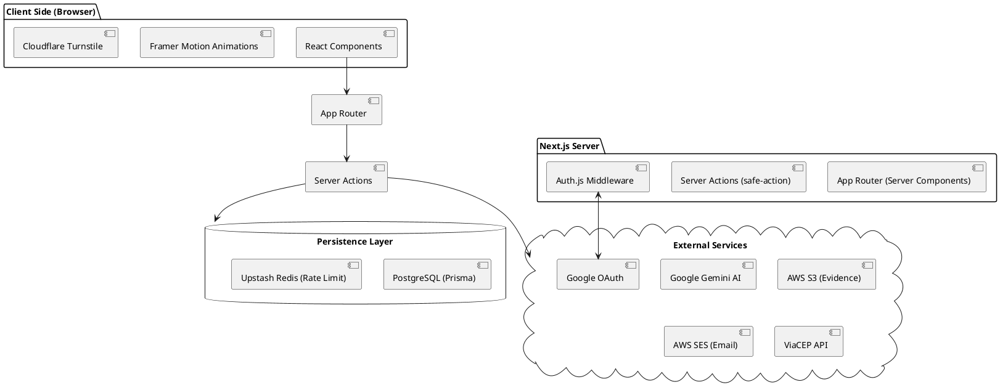

# 07 - Arquitetura do Sistema

## 7.1 Visão Geral da Arquitetura

O **AnonProtect** utiliza uma arquitetura fullstack moderna baseada no framework Next.js. O sistema é dividido em três camadas lógicas principais: Frontend, Backend e Camada de Dados.

### 7.1.1 Frontend (React Server Components)

Responsável pela interface do usuário e renderização otimizada. Utiliza componentes do lado do servidor para reduzir o tempo de carregamento e componentes de cliente para interatividade (como o chat e o dashboard).

### 7.1.2 Backend (Server Actions & API Routes)

Processa a lógica de negócio, autenticação e validação de dados. As **Server Actions** atuam como ponte segura entre o formulário do usuário e o banco de dados, enquanto as API Routes lidam com integrações externas como o callback do Google OAuth.

### 7.1.3 Camada de Dados (Prisma & PostgreSQL)

Gerencia a persistência das informações. O Prisma atua como a interface de consulta, garantindo integridade referencial e tipagem forte em todas as operações. O sistema também utiliza o **Upstash Redis** para gerenciamento de rate limit distribuído.

## 7.2 Diagrama de Arquitetura (PlantUML)

## 7.3 Segurança e Privacidade (LGPD)

O sistema foi projetado seguindo os princípios de _Privacy by Design_:

### 7.3.1 Criptografia em Repouso

Todas as descrições de denúncias são criptografadas utilizando o algoritmo **AES-256-GCM** antes de serem persistidas no banco de dados. Isso garante que, mesmo em caso de vazamento da base de dados, o conteúdo permanece ilegível sem a `ENCRYPTION_KEY`.

### 7.3.2 Camada de Anonimização (PII Redaction)

Utiliza-se Inteligência Artificial (Gemini) para detectar e redigir automaticamente Informações de Identificação Pessoal (PII) como nomes, e-mails, CPFs e telefones, gerando uma versão segura para visualização padrão.

### 7.3.3 Auditoria Ética

Cada acesso a dados sensíveis por administradores gera um log de auditoria impermutável (`VIEWED`), garantindo transparência e responsabilidade no tratamento dos dados.

## 7.4 Infraestrutura e Fluxo de Dados

O fluxo de uma denúncia inicia-se na camada de cliente, é validado por um schema **Zod** no servidor, processado pela Server Action correspondente e persistido via Prisma. A resposta retorna apenas o código de rastreio, mantendo o estado da aplicação limpo e seguro.
