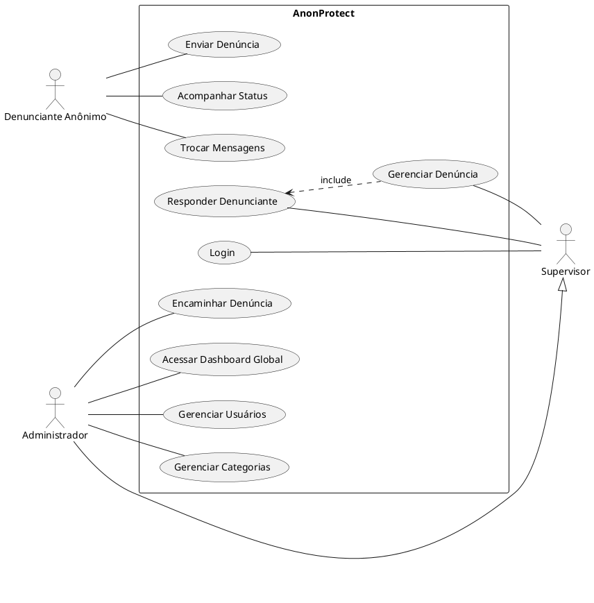

# 09 - Casos de Uso

## 9.1 Atores do Sistema

- **Denunciante Anônimo**: Usuário externo que reporta irregularidades.
- **Supervisor**: Gestor que analisa e responde denúncias de seu departamento.
- **Administrador**: Gestor com poderes globais, gerenciamento de usuários e categorias.

## 9.2 Descrição dos Casos de Uso

### UC01 - Enviar Denúncia Anônima

- **Ator**: Denunciante Anônimo.
- **Descrição**: O usuário preenche o formulário com o relato, seleciona a categoria e anexa evidências. O sistema processa e retorna um código de rastreio exclusivo.
- **Requisito**: Não deve exigir login.

### UC02 - Acompanhar Denúncia

- **Ator**: Denunciante Anônimo.
- **Descrição**: O usuário insere seu código de rastreio para verificar o status e ler mensagens da administração.

### UC03 - Autenticar Gestor

- **Ator**: Supervisor / Administrador.
- **Descrição**: O gestor faz login via credenciais ou Google OAuth para acessar o painel.

### UC04 - Gerenciar Denúncia (Investigar)

- **Ator**: Supervisor / Administrador.
- **Descrição**: O gestor altera o status da denúncia, adiciona notas internas de investigação e responde ao denunciante.

### UC05 - Encaminhar Denúncia

- **Ator**: Administrador / Supervisor.
- **Descrição**: Alterar o departamento responsável por uma denúncia específica.

### UC06 - Gerenciar Configurações do Sistema

- **Ator**: Administrador.
- **Descrição**: Criar e editar categorias, departamentos e usuários do sistema.

## 9.3 Diagrama de Casos de Uso (PlantUML)

