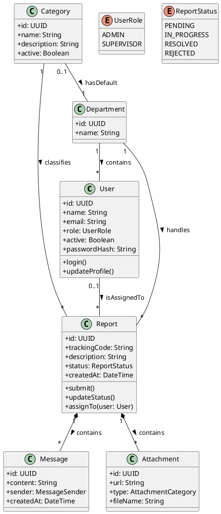

# 10 - Diagrama de Classes

## 10.1 Estrutura de Classes Logicas

Dada a arquitetura baseada em Next.js e Prisma, as "classes" do sistema são representadas pelos modelos de dados e pelas Server Actions que encapsulam a lógica de negócio.

## 10.2 Diagrama de Classes UML (PlantUML)

## 10.3 Detalhamento das Relações

O diagrama ilustra a forte coesão organizacional: as denúncias são classificadas por categorias que, por sua vez, apontam para departamentos responsáveis. O usuário administrativo atua sobre as denúncias atribuídas ao seu departamento.
