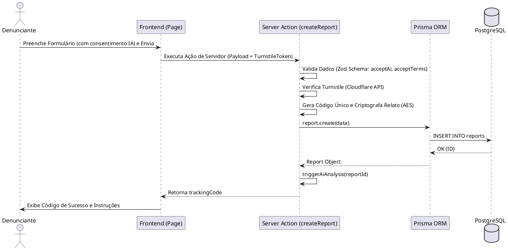
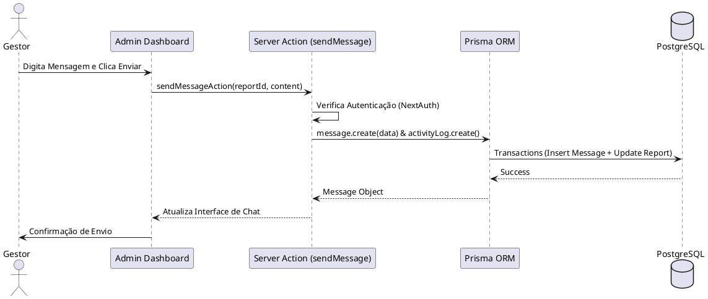

# 11 - Diagrama de Sequência

## 11.1 Fluxo de Submissão de Denúncia

Este diagrama ilustra o processo desde o preenchimento do formulário pelo denunciante até a persistência no banco de dados e o retorno do código de rastreio.

## 11.2 Fluxo de Resposta do Administrador

Ilustra como um gestor autenticado interage com o sistema para responder a uma ocorrência.

