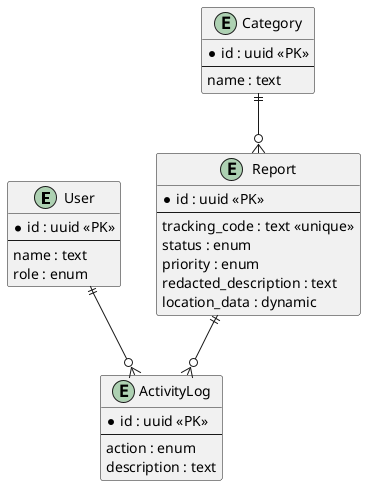

# 12 - Modelo de Dados

## 12.1 Dicionário de Dados

Abaixo estão detalhadas as principais tabelas do banco de dados relacional (PostgreSQL) gerenciado via Prisma.

### 12.1.1 Tabela `reports` (Denúncias)

| Field                | Type            | Description                                         |
| -------------------- | --------------- | --------------------------------------------------- |
| id                   | UUID (PK)       | Identificador interno único                         |
| tracking_code        | String (Unique) | Código para rastreamento (ex: AP-2026-X8Y2)         |
| description          | Text            | Relato detalhado da ocorrência                      |
| status               | Enum            | PENDING, IN_PROGRESS, RESOLVED, REJECTED, ARCHIVED  |
| priority             | Enum            | LOW, MEDIUM, HIGH, CRITICAL                         |
| country              | String          | País da ocorrência                                  |
| city                 | String          | Cidade da ocorrência                                |
| category_id          | UUID (FK)       | Vínculo com a tabela de categorias                  |
| redacted_description | Text (Encryp)   | Versão anonimizada do relato para conformidade LGPD |
| created_at           | DateTime        | Data e hora da submissão                            |

### 12.1.2 Tabela `activity_logs` (Histórico de Auditoria)

Manutenção automática do rastro de ações administrativas.

| Campo       | Tipo      | Descrição                                        |
| ----------- | --------- | ------------------------------------------------ |
| id          | UUID (PK) | Identificador único                              |
| action      | Enum      | STATUS_CHANGED, DEPARTMENT_CHANGED, VIEWED, etc. |
| description | Text      | Descrição legível da ação                        |

## 12.2 Modelo Entidade-Relacionamento (ER)

