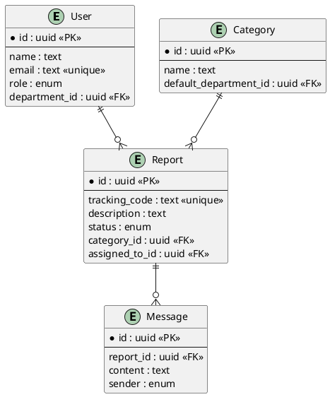

# 12 - Modelo de Dados

## 12.1 Dicionário de Dados

Abaixo estão detalhadas as principais tabelas do banco de dados relacional (PostgreSQL) gerenciado via Prisma.

### 12.1.1 Tabela `reports` (Denúncias)

| Campo          | Tipo            | Descrição                                   |
| -------------- | --------------- | ------------------------------------------- |
| id             | UUID (PK)       | Identificador interno único                 |
| tracking_code  | String (Unique) | Código para rastreamento (ex: AP-2025-X8Y2) |
| description    | Text            | Relato detalhado da ocorrência              |
| status         | Enum            | PENDING, IN_PROGRESS, RESOLVED, REJECTED    |
| category_id    | UUID (FK)       | Vínculo com a tabela de categorias          |
| assigned_to_id | UUID (FK)       | Usuário gestor responsável                  |
| created_at     | DateTime        | Data e hora da submissão                    |

### 12.1.2 Tabela `users` (Usuários Gestores)

| Campo         | Tipo            | Descrição                            |
| ------------- | --------------- | ------------------------------------ |
| id            | UUID (PK)       | Identificador único                  |
| email         | String (Unique) | E-mail de acesso                     |
| password      | String (Hash)   | Senha criptografada (bcrypt)         |
| role          | Enum            | ADMIN, SUPERVISOR                    |
| department_id | UUID (FK)       | Vínculo com o departamento do gestor |

### 12.1.3 Tabela `categories` (Categorias)

| Campo                 | Tipo            | Descrição                                |
| --------------------- | --------------- | ---------------------------------------- |
| id                    | UUID (PK)       | Identificador único                      |
| name                  | String (Unique) | Nome (ex: Bullying, Assédio)             |
| default_department_id | UUID (FK)       | Departamento para encaminhamento inicial |

## 12.2 Modelo Entidade-Relacionamento (ER)

O modelo foi projetado para normalização e integridade. As chaves estrangeiras garantem que uma denúncia não fique sem categoria e que histórico de mensagens seja removido apenas se a denúncia for excluída (onDelete: Cascade).

